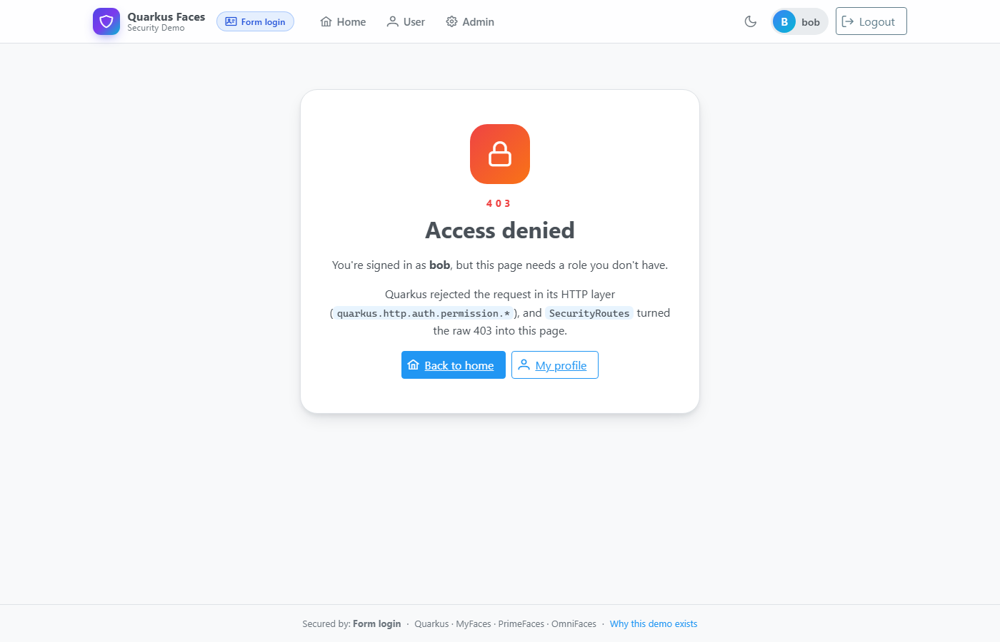
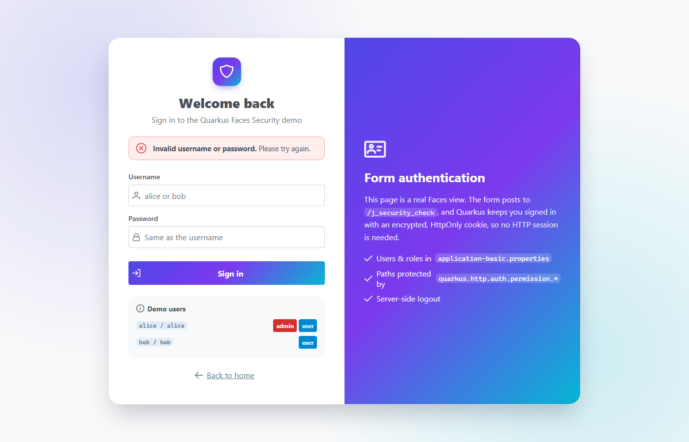
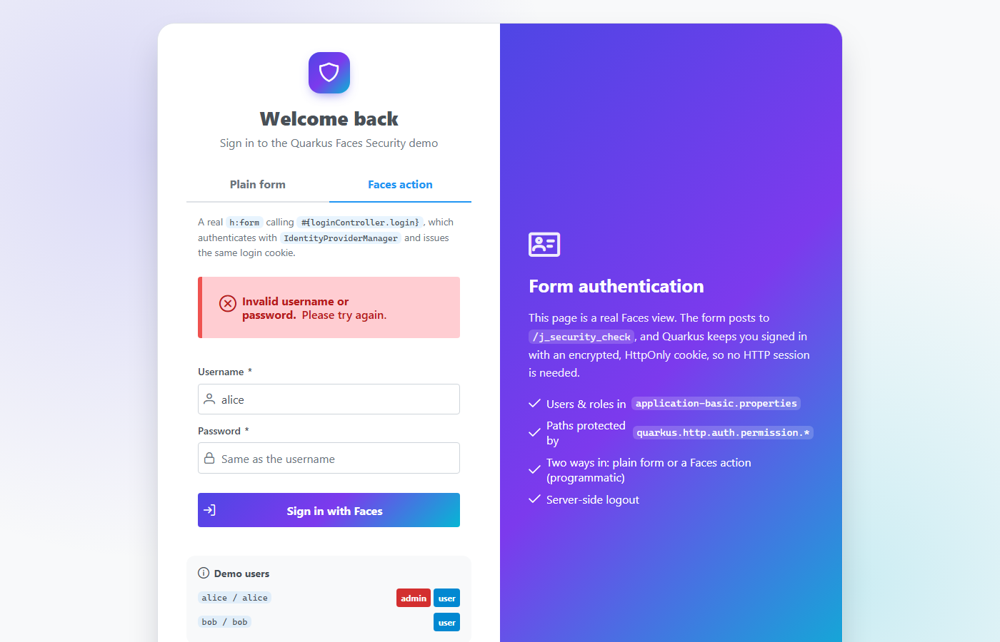
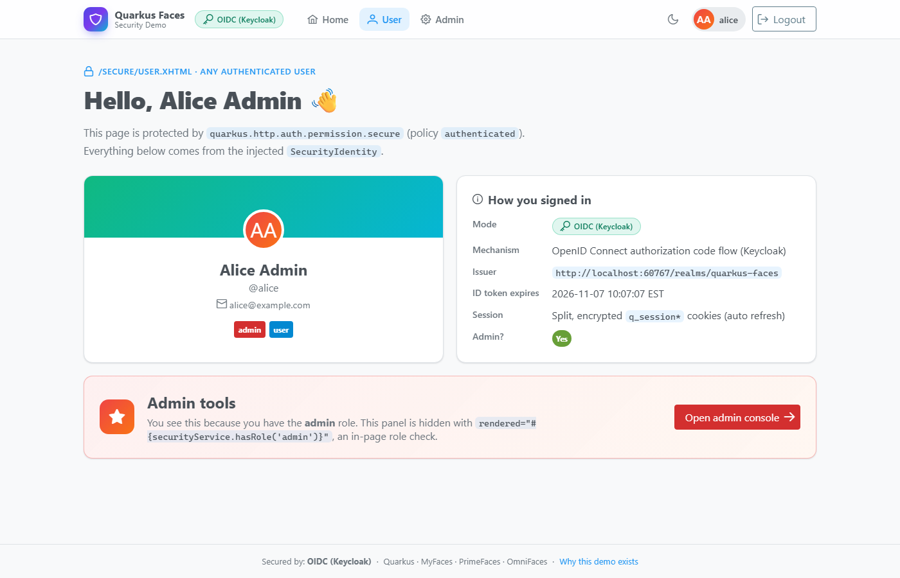
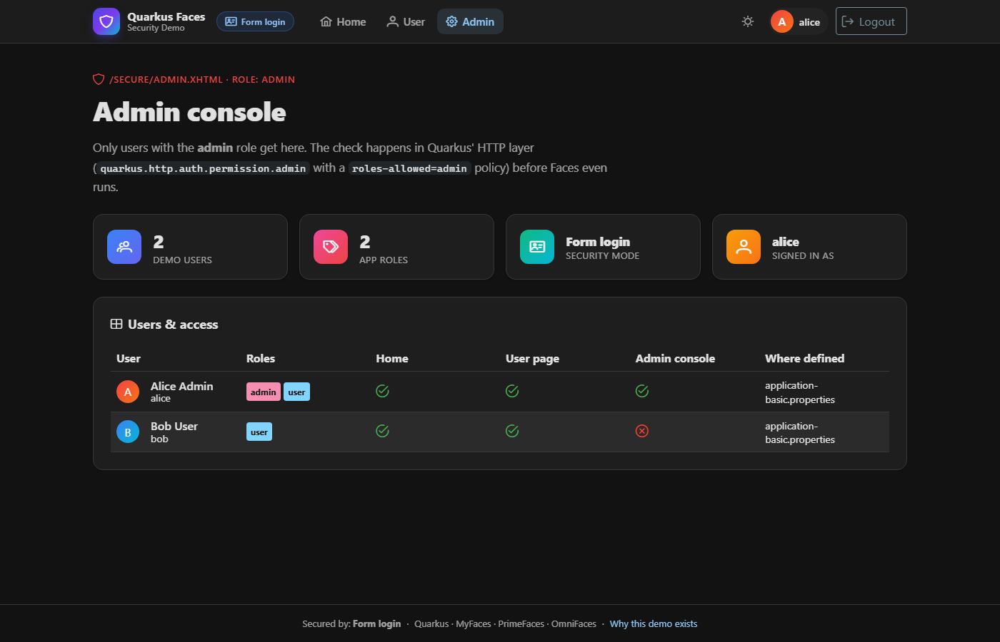

Ever since I wrote about [Quarkus Faces](/blog/quarkus-faces/), one question keeps coming back in issues, discussions and
client engagements: **how do I secure my Faces application on Quarkus?** The questions in
[quarkus-faces#409](https://github.com/melloware/quarkus-faces/issues/409) sum it up pretty well:

- How do I put a real login **page** in front of my Faces views? Quarkus has no servlet-style `request.login()`, so the usual Jakarta EE answers don't work.
- How do I log out?
- How do I move to OIDC/Keycloak later without rewriting all my pages?

So I built a small demo that answers all three in one place:
[melloware/quarkus-faces-security](https://github.com/melloware/quarkus-faces-security).

## One App, Three Modes

The demo uses Quarkus with [MyFaces](https://myfaces.apache.org), [PrimeFaces](https://primefaces.org) and
[OmniFaces](https://omnifaces.org), and secures the **same pages, users and roles** in different ways depending on which
Maven profile you run:

| Command | Mode | What you get |
|---|---|---|
| `mvn quarkus:dev` | **Unsecured** | Only the public home page, with a warning banner. `/secure/**` is blocked. |
| `mvn -Pbasic` | **Form login** | A PrimeFaces login page (Quarkus form authentication) backed by embedded users. |
| `mvn -Poidc` | **OIDC** | Login through Keycloak, started automatically by Quarkus Dev Services. |

Both secured modes have the same two users: `alice` / `alice` (roles `admin` and `user`) and `bob` / `bob` (role `user` only).
Bob can see the user page but gets a friendly 403 when he tries the admin console.

Each Maven profile sets `quarkus.profile`, which layers a profile-specific properties file on top of `application.properties`,
and each profile only adds the JARs its mode actually needs:

| Build | Security JARs on the classpath |
|---|---|
| default | `quarkus-security` only: there's no way to log in |
| `-Pbasic` | + `quarkus-elytron-security-properties-file` |
| `-Poidc` | + `quarkus-oidc`, `quarkus-jackson` |

Because code that touches `JsonWebToken` can't compile without the OIDC JARs, it lives in a separate source folder
(`src/main/oidc/java`) that only the `oidc` profile adds via `build-helper-maven-plugin`. A small `TokenClaims` interface
with a `@DefaultBean` no-op implementation keeps the rest of the app oblivious.

## Path-Level Security

Both secured modes use the same HTTP permission rules. Quarkus enforces them in its HTTP layer **before** the Faces servlet
ever runs, so `web.xml` needs no `<security-constraint>` entries at all:

```properties
quarkus.http.auth.permission.secure.paths=/secure/*
quarkus.http.auth.permission.secure.policy=authenticated
quarkus.http.auth.policy.admin-only.roles-allowed=admin
quarkus.http.auth.permission.admin.paths=/secure/admin.xhtml
quarkus.http.auth.permission.admin.policy=admin-only
```

The catch is that these 403s never reach Faces, so a `web.xml` `<error-page>` can't catch them. A small Vert.x failure
handler in `SecurityRoutes` redirects them to a styled `access-denied.xhtml` page instead.



## One Bean That Knows the Mode

Every page talks to `#{securityService}` and never to a specific security mechanism:

```xml
<ui:fragment rendered="#{securityService.hasRole('admin')}"> ...admin-only panel... </ui:fragment>
<p:commandButton value="Logout" action="#{securityService.logout}" ajax="false"/>
```

`SecurityService` wraps the injected `SecurityIdentity` and does the right thing on logout for the active mode. With form
login it removes the encrypted `quarkus-credential` cookie; with OIDC it redirects to the `quarkus.oidc.logout.path` so you
are logged out of Keycloak too (RP-initiated logout). Your pages don't care which one is active, which is exactly what makes
moving from form login to OIDC painless.

And since Quarkus propagates its `SecurityIdentity` into the servlet container, plain Servlet API calls like
`getUserPrincipal()`, `getRemoteUser()` and `isUserInRole()` work in both modes too, including `#{request.userPrincipal.name}` in EL.

## Form Login Without `request.login()`

The login page is a normal Faces view, but its form is a **plain HTML `<form>`**, not `h:form`. It posts `j_username` and
`j_password` straight to `/j_security_check`, and Quarkus does the rest:

```properties
quarkus.http.auth.form.enabled=true
quarkus.http.auth.form.login-page=/login.xhtml
quarkus.http.auth.form.error-page=/login.xhtml?error=true
quarkus.http.auth.form.landing-page=/secure/user.xhtml
quarkus.http.auth.form.http-only-cookie=true
quarkus.http.auth.session.encryption-key=change-me-...   # use a real secret in production!
```

You stay logged in through an encrypted cookie rather than the HTTP session, so it also works across a cluster.



## Programmatic Login From a Faces Action

This is the one people really want. A plain form is fine, but many apps need the login to be a **Faces action method** so
they can use PrimeFaces components and validation, `p:messages`, ajax, and run their own checks first (captcha, account
lockout, auditing). The workaround floating around in #409 has the server POST to its own `/j_security_check` with an
`HttpClient` and copy the `Set-Cookie` header back. That's fragile: it breaks behind proxies, with context paths and TLS,
and doesn't even URL-encode the password.

The demo's `LoginController` instead does in-process exactly what `j_security_check` does:

```java
@Inject IdentityProviderManager identityProviderManager;
@Inject CurrentVertxRequest currentVertxRequest;

public void login() throws IOException {
    // 1. Check the credentials with the same identity providers form auth uses
    SecurityIdentity identity = identityProviderManager.authenticateBlocking(
            new UsernamePasswordAuthenticationRequest(username, new PasswordCredential(password.toCharArray())));
    //    -> AuthenticationFailedException on bad credentials: add a FacesMessage and stay on the page

    // 2. Issue the SAME encrypted quarkus-credential cookie form auth would
    RoutingContext rc = currentVertxRequest.getCurrent();
    loginManager(http, form).save(identity, rc, null, rc.request().isSSL());

    // 3. Redirect to the page originally requested, or the landing page
    external.redirect(contextPath + redirectTarget(rc, form));
}
```

```xml
<h:form id="progForm">
    <p:messages id="progMessages"/>
    <p:inputText id="username" value="#{loginController.username}" required="true"/>
    <p:password  id="password" value="#{loginController.password}" required="true"/>
    <p:commandButton value="Sign in with Faces" action="#{loginController.login}" process="@form" update="@form"/>
</h:form>
```

Because the cookie is identical to the one `j_security_check` creates, everything after login just works: path permissions,
`SecurityIdentity`, `getUserPrincipal()` and logout.



> **Caveat:** `PersistentLoginManager` lives in a Quarkus `runtime` package and isn't a documented API, while
> `IdentityProviderManager` is. Re-run the tests when you upgrade Quarkus; the demo has a Playwright test covering this flow end to end.

## OIDC With Keycloak Dev Services

Run `mvn -Poidc` and Quarkus Dev Services pulls and starts Keycloak in a container and imports a realm file with the same
users and roles. Clicking **Login** now takes you to Keycloak's login screen instead, and nothing in the Faces pages changed.



A few gotchas I hit along the way:

- Keycloak puts realm roles in the **access** token, so you need `quarkus.oidc.roles.source=accesstoken`.
- The ID, access and refresh tokens together are too big for one cookie, so set `quarkus.oidc.token-state-manager.split-tokens=true`.
- OIDC needs `quarkus-jackson` on the classpath to read Keycloak's JSON metadata.

## Tested in Every Mode

Since each mode has different JARs on the classpath, each one is tested in its own build using JUnit 5 tags,
RestAssured and [Quarkus Playwright](https://docs.quarkiverse.io/quarkus-playwright/dev/) for real browser tests: full login,
admin access, Bob being denied, the programmatic login messages, and single logout through Keycloak.

```bash
mvn verify && mvn -Pbasic verify && mvn -Poidc verify
```



## Use It In Your Own App

1. Copy the three properties files and the `basic` / `oidc` Maven profiles.
2. Put protected views under `/secure/` (or change the permission paths).
3. Copy `login.xhtml`, using either the plain `j_security_check` form or the Faces-action version with `LoginController`.
4. Copy `SecurityService` and have your pages only use `#{securityService...}`.
5. Optionally copy `SecurityRoutes` for friendly 403 pages.

Check out the code at [melloware/quarkus-faces-security](https://github.com/melloware/quarkus-faces-security) and let me
know if it helps you secure your Faces applications on Quarkus!
